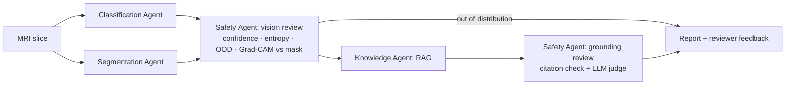

# NeuroScan Agent

**A multi-agent AI system for brain tumor detection from MRI scans.**

Gideon Apatewen Agbanga · Kumar Chapagain · Sanjaya Basnet · Sudeep Sharma · Thel Theint Theint Sen

> Research prototype for decision support only. Not a medical device and not for clinical
> diagnosis. Every output must be confirmed by a qualified radiologist.

## What it does

Upload one MRI slice and four agents analyze it:

| Agent | Method | Output |
|---|---|---|
| **Classification** | EfficientNet-B0 (timm), temperature-scaled | glioma / meningioma / pituitary / no tumor, calibrated confidence, MC-dropout uncertainty, OOD score |
| **Segmentation** | 2D U-Net (MONAI) | tumor mask, area (% of brain), location in the image, extent |
| **Knowledge** | RAG over a curated knowledge base (ChromaDB) + LLM | short background note on the predicted type, every sentence cited |
| **Safety** | rules + Grad-CAM + LLM judge | flags uncertain or inconsistent cases for review; removes unsupported explanation sentences |



Classification and segmentation run in parallel in LangGraph (`src/neuroscan/graph.py`).

## Data design (read this before training)

| Dataset | Used for | Notes |
|---|---|---|
| [Kaggle Brain Tumor MRI](https://www.kaggle.com/datasets/masoudnickparvar/brain-tumor-mri-dataset) | classifier train/val/test | **Contains the Figshare images.** `dedup.py` removes them plus internal duplicates. |
| [Figshare, Cheng et al.](https://figshare.com/articles/dataset/brain_tumor_dataset/1512427) | U-Net training (its tumor masks) **and** the classifier's external test | split **by patient ID**; the classifier never sees Figshare |
| BraTS | optional / future work | 3D NIfTI, mainly gliomas; does not match 2D JPG inputs |

Size is reported in pixels and % of brain area because 2D JPG/PNG slices carry no pixel
spacing. Location is reported in image coordinates ("image-left"), not patient hemisphere.

## Repository layout

```
configs/config.yaml          all settings and thresholds
src/neuroscan/
  data/      prepare_figshare.py · dedup.py · make_splits.py · datasets.py
  models/    classifier.py (CNN, temperature scaling, Mahalanobis OOD) · unet.py · registry.py
  agents/    state.py · classification.py · segmentation.py · safety.py · knowledge.py · report.py
  rag/       ingest.py · retriever.py
  explain/   gradcam.py
  eval/      evaluate_classifier.py · evaluate_segmentation.py · evaluate_safety.py
             evaluate_grounding.py · summarize_feedback.py
  graph.py   LangGraph workflow     llm.py   Claude / OpenAI wrapper
  train_classifier.py · train_segmentation.py
app/streamlit_app.py         reviewer UI with feedback form
notebooks/colab_train.ipynb  end-to-end training on Colab GPU
knowledge_base/              sources.yaml manifest + source documents
tests/                       smoke tests (run without data, weights or API keys)
```

## Quickstart

```bash
git clone https://github.com/<your-org>/neuroscan-agent.git && cd neuroscan-agent
python -m venv .venv && source .venv/bin/activate
pip install -r requirements.txt && pip install -e .
cp .env.example .env            # add ANTHROPIC_API_KEY or OPENAI_API_KEY
pytest -q                       # 5 smoke tests, no data needed
```

Training is easiest on Colab: open `notebooks/colab_train.ipynb`. Everything persists to Google Drive.

### 1. Data

```bash
# put Kaggle data in data/raw/kaggle/{Training,Testing}/<class>/ and Figshare .mat files in data/raw/figshare/
python -m neuroscan.data.prepare_figshare   # .mat -> PNG image + mask + figshare.csv
python -m neuroscan.data.dedup              # leakage + duplicate check; inspect data/splits/dedup_pairs.csv
python -m neuroscan.data.make_splits        # kaggle_{train,val,test}.csv, figshare_{train,val,test,all}.csv
```

### 2. Train

```bash
python -m neuroscan.train_classifier                              # -> checkpoints/classifier.pt
python -m neuroscan.train_classifier --balance none --tag nobal   # ablation for the bias study
python -m neuroscan.train_segmentation                            # -> checkpoints/unet.pt
```

### 3. Knowledge base

Add 20-30 trusted documents to `knowledge_base/sources/`, list them in `knowledge_base/sources.yaml`, then:

```bash
python -m neuroscan.rag.ingest --reset
```

### 4. Run

```bash
streamlit run app/streamlit_app.py
python -m neuroscan.graph path/to/scan.jpg      # same pipeline, JSON report in the terminal
```

### 5. Evaluate

```bash
python -m neuroscan.eval.evaluate_classifier --split kaggle_test     # in-distribution
python -m neuroscan.eval.evaluate_classifier --split figshare_all    # external source
python -m neuroscan.eval.evaluate_segmentation --split figshare_test
python -m neuroscan.eval.evaluate_safety --split kaggle_val --sweep  # choose thresholds on val...
python -m neuroscan.eval.evaluate_safety --split kaggle_test         # ...report on test
python -m neuroscan.eval.evaluate_grounding generate                 # then hand-label, then:
python -m neuroscan.eval.evaluate_grounding summarize
python -m neuroscan.eval.summarize_feedback
```

All results land in `results/` as JSON, CSV and PNG.

## Safety flags

| Flag | Raised when |
|---|---|
| `low_confidence` | calibrated max probability < `min_confidence` |
| `high_uncertainty` | MC-dropout predictive entropy > `max_entropy` |
| `out_of_distribution` | Mahalanobis distance of CNN features > 99th percentile of validation |
| `attention_outside_tumor` | < `min_cam_in_mask` of Grad-CAM energy falls inside the dilated U-Net mask |
| `tumor_predicted_no_mask` / `mask_but_no_tumor_predicted` | classifier and segmenter disagree |
| `explanation_poorly_grounded` | the grounding review removed > 25% of explanation sentences |
| `grounding_check_failed`, `no_knowledge_retrieved`, `invalid_image` | pipeline problems |

**AI feedback (RLAIF-style):** an LLM judge checks every cited sentence against its source before display.
**Human feedback (RLHF-style):** reviewer ratings from the app are logged to `feedback/feedback.csv` and used to
retune thresholds, prompts and retrieval. No model weights are fine-tuned from feedback.

## Team ownership (4 weeks)

| Week | Data + Classification (2) | Segmentation (1) | Knowledge / RAG (1) | Orchestration + UI (1) |
|---|---|---|---|---|
| 1 | download, dedup, splits, baseline CNN | Figshare prep, first U-Net | collect sources, ingest | run smoke tests, app on untrained weights |
| 2 | balancing, calibration, Grad-CAM, eval | Dice, HD95, size/location | prompt + grounding review | plug in real models |
| 3 | safety sweep on val | help with safety evaluation | hallucination labeling | **end-to-end demo frozen** |
| 4 | final tables, ablation | figures | reviewer study (≈20 cases × 3-5 reviewers) | demo video; everyone writes the report |

Agree on `agents/state.py` before changing it: it is the contract between agents.

## References

1. Menze et al. (2015). The Multimodal Brain Tumor Image Segmentation Benchmark (BRATS). *IEEE TMI*.
2. Ronneberger, Fischer & Brox (2015). U-Net: Convolutional Networks for Biomedical Image Segmentation. *MICCAI*.
3. Cheng et al. (2015). Enhanced Performance of Brain Tumor Classification via Tumor Region Augmentation and Partition. *PLOS ONE*.
4. Selvaraju et al. (2017). Grad-CAM: Visual Explanations from Deep Networks via Gradient-based Localization. *ICCV*.
5. Guo et al. (2017). On Calibration of Modern Neural Networks. *ICML*.
6. Lee et al. (2018). A Simple Unified Framework for Detecting Out-of-Distribution Samples and Adversarial Attacks. *NeurIPS*.
7. Gal & Ghahramani (2016). Dropout as a Bayesian Approximation. *ICML*.
